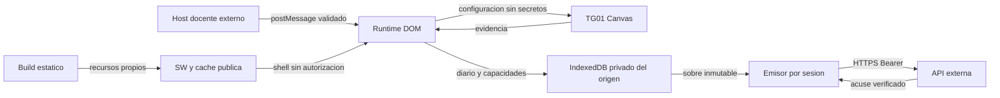

# Modelo de amenazas — Kudlab Play / J-01

## Executive summary

Las fronteras principales son el puente docente, las capacidades por sesión y la transición diario → acuse. Hay controles y pruebas de suplantación de mensajes, asociación A/B, respuesta perdida y limpieza concurrente. Siguen siendo riesgos relevantes el origen comprometido, los dispositivos compartidos, la evicción y un navegador que fabrique evidencia. Esta revisión no certifica seguridad, consentimiento o validez científica.

## Scope and assumptions

Confirmados con el responsable antes de implementar: frontend estático con HTTPS y orígenes exactos en producción; API/host externos; perfiles compartidos sin protección frente al dueño del navegador; solo datos sintéticos. Alcance: `src/`, scripts de build y separación de `tests/simulator/`. Fuera: J-02/J-03, PostgreSQL, autenticación docente, infraestructura institucional y dispositivos físicos.

Preguntas abiertas antes de habilitar: hosting y orígenes reales; aplicación efectiva de CSP/CORS; política institucional de conservación/revocación; navegadores/dispositivos admitidos. Cambiar estos supuestos puede elevar la prioridad de riesgos de exfiltración o pérdida.

## System model

### Primary components

Shell DOM (`src/app/app.ts`), módulo Canvas confiable (`src/games/`), cliente contractual (`src/delivery/api.ts`), IndexedDB (`src/storage/database.ts`), diario/outbox (`src/evidence/journal.ts`, `src/delivery/outbox.ts`). SW y cabeceras se generan desde `scripts/build-sw.mjs`. El simulador es solo plugin Vite de desarrollo; no forma parte de `dist/`.

### Data flows and trust boundaries

- Docente → runtime: postMessage con grant y bridgeId. Origen exacto, source parent, UUID y objeto estricto; `src/bridge/supervised.ts:4–20`. El host debe comprobar generación/usuario, fuera de J-01.
- Runtime → API: JSON estricto y Bearer limitado, HTTPS salvo loopback, credentials omit, redirects rechazados, no-store, timeout; `src/delivery/api.ts:10–35`. La API conserva autoridad y requiere CORS/no-store propios.
- Módulo → shell: snapshots del reloj/estímulos/incidencias, sin capacidad ni cliente HTTP; `src/games/registry.ts`, `src/games/tg01/engine.ts`. No es aislamiento frente a código malicioso del mismo origen.
- Shell → IndexedDB: diario y secretos por sesión, transacciones y leases; `src/storage/database.ts`, `src/evidence/journal.ts`. Acceso del mismo perfil/origen no está separado criptográficamente.
- IndexedDB → API → acuse: paquete inmutable, SHA-256/RFC8785 e IDs coincidentes antes de limpieza; `src/delivery/outbox.ts:28–60`.
- Build → hosting → SW: allowlist pública versionada y cabeceras, sin operaciones de evidencia; `scripts/build-sw.mjs`. Deben desplegarse únicamente los archivos de dist.

#### Diagram

## Assets and security objectives

| Activo | Por qué importa | Objetivo |
| --- | --- | --- |
| Grant/runtimeSecret | Capacidad de reclamar/iniciar/entregar una sesión | C/I |
| Contexto y asociación por sesión | Impedir atribuir evidencia a otro participante | I |
| Diario y sobre | No fabricar omisiones, duplicar o perder registros comprometidos | I/A |
| Acuse mínimo | Diferenciar commit remoto de fin local | I |
| Artefacto/lockfile/CSP | No distribuir bypass, terceros o scripts comprometidos | I/C |

## Attacker model

### Capabilities

Un sitio externo puede enviar mensajes al frame, provocar cambios de foco/red o intentar incrustarlo. Una persona con acceso al perfil puede leer/alterar IndexedDB, inspeccionar capacidades y fabricar eventos. Un script del mismo origen o dependencia comprometida tendría privilegios equivalentes al runtime.

### Non-capabilities

No se asume que un origen remoto pueda leer IndexedDB de otro origen, saltar HTTPS o emitir grants válidos sin comprometer la API. El hash no demuestra autoría física; tampoco vuelve confiable un navegador controlado.

## Entry points and attack surfaces

| Superficie | Acceso / frontera | Control / evidencia |
| --- | --- | --- |
| URL bridgeId | Navegación no confiable | Solo correlación pública UUID; `App.init`, puente |
| postMessage | Ventana externa → runtime | Objeto estricto, source y origen; `acceptsAuthorization` |
| Respuestas API | Servidor externo → cliente | Contexto/hash/acuse estrictos; `Api` |
| IndexedDB | Perfil/origen → recuperación | Validación de sobre, checkpoint/clock y capacidades por sesión; `Journal`, `Delivery` |
| Pointer/RAF/foco/layout | Navegador → medición | Ventanas, primario, corte técnico y límites; `Engine` |
| Variables build | Operador → artefacto | Orígenes exactos, sin secretos; `build-sw.mjs` |
| Simulador/CI/dependencias | Desarrollo → distribución | Configuración separada y escaneo dist; `check-production.mjs`, lockfile |

## Top abuse paths

1. Sitio malicioso → mensaje de autorización con source/origen falsos → intentar tomar sesión. Se rechaza antes de HTTP.
2. Script del origen comprometido → leer runtimeSecret/diario → exfiltrar o falsificar. CSP y ausencia de terceros reducen entrada, no protegen frente al dueño del perfil.
3. Respuesta 2xx incorrecta → aparentar guardado → borrar el único respaldo. Se exige acuse coincidente y hash.
4. Pestaña suspendida → lease vencido y segundo emisor → respuesta tardía resucita evidencia. El commit del acuse y la actualización transaccional impiden resurrección.
5. Nueva autorización B → seleccionar credencial/pendiente A → atribución cruzada. Bridge nuevo no selecciona preparación ajena; outbox recupera su capacidad por sessionId.
6. Recarga/cuota/actualización → usar reloj nuevo o borrar diario → resultados falsos/pérdida. Se recupera checkpoint original, sin reanudar y con error explícito.

## Threat model table

| ID | Fuente / prerrequisito | Acción e impacto | Activos | Controles existentes | Brecha / recomendación | Detección | Probabilidad | Impacto | Prioridad |
| --- | --- | --- | --- | --- | --- | --- | --- | --- | --- |
| TM-001 | Sitio remoto con referencia al frame | Suplantar grant/sesión | Capacidad/asociación | `supervised.ts`, AC14 | Verificar además host/generación real en J-02 | Tests negativos, sin registrar mensajes secretos | Baja por validación exacta | Alto si se elimina la frontera | medium |
| TM-002 | XSS/dependencia/origen comprometido | Robar secretos y evidencia | C/I | DOM seguro, CSP generada, recursos locales | Verificar hosting, auditar dependencias y limitar origen a esta app | CSP operativa sin cuerpos/tokens; escaneo build | Media, depende del despliegue | Alto | high |
| TM-003 | Respuesta corrupta o falsa | Borrar evidencia sin commit | Sobre/acuse | `outbox.ts`, validación IDs/hash | Verificar API real y semántica transaccional J-02 | AC07/09 y alertas API sin paquetes | Baja con acuse estricto | Alto | medium |
| TM-004 | Pestaña concurrente/suspendida | Duplicación o resurrección de pendiente | Asociación/I | Leases, startId, acuse persistido, actualización condicional | Concurrencia servidor real sigue pendiente | AC11 y prueba emisor obsoleto | Media en dispositivos compartidos | Alto | high |
| TM-005 | Otro usuario del perfil | Leer capacidad o cambiar estudiante de un envío | C/asociación | No nombres, secreto por sesión, bridge ligado; AC12 | Aislamiento operacional del perfil y conservación aprobada; no prometer cifrado frente al usuario local | Intervención docente; nunca exportar paquetes | Media por uso compartido | Alto | high |
| TM-006 | Cuota, evicción, cierre o frame suspendido | Perder evidencia o fabricar tiempo ausente | I/A | IndexedDB incremental, clock fijo, FULLY_VISIBLE, preflight; AC08/10 | Pruebas físicas y políticas de almacenamiento institucional | Incidencias tipadas, sin mensajes libres | Media por límites del navegador | Alto | high |
| TM-007 | Hosting/build/SW mal configurado | Distribuir bypass, cachear secreto o borrar pendientes | Todos | Grafo separado, escaneo, SW allowlist, migración aditiva | Cabeceras reales y actualización en navegadores institucionales; cachés antiguas requieren gestión futura | AC13/17 y revisión de artefacto | Media hasta configurar hosting | Alto | high |
| TM-008 | Propietario de navegador controlado | Fabricar evidencia plausible | I metodológica | API debe validar asociación/coherencia; cliente declara límites | No hay prueba de respuesta física ni validación clínica por hash | Revisiones metodológicas, no clasificación automática infantil | Alta si ese actor es adversario | Alto para uso científico | high |

## Criticality calibration

- **critical**: compromiso masivo de capacidades o inclusión de bypass productivo que la API acepte. No demostrado en esta revisión.
- **high**: pérdida/asociación cruzada de evidencia, robo de capacidad del perfil u omisiones fabricadas con impacto sobre decisiones docentes.
- **medium**: abuso de mensajes sin acceso a capacidad, bloqueo recuperable de entrega o límite operativo mitigado por validación.
- **low**: defecto de presentación sin pérdida/asociación o acumulación limitada de recursos estáticos sin secretos. Vigilar presión de cuota.

## Focus paths for security review

| Ruta | Revisión recomendada | Amenazas |
| --- | --- | --- |
| `src/bridge/supervised.ts` | Origen/source/esquema y host real | TM-001 |
| `src/runtime/session.ts` | Reconciliación y capacidades por sesión | TM-004/005 |
| `src/delivery/outbox.ts` | Acuses, limpieza y emisores obsoletos | TM-003/004 |
| `src/evidence/journal.ts` | Transacciones, reloj original e inmutabilidad | TM-006 |
| `src/storage/database.ts` | Errores, upgrades y leases | TM-004/006 |
| `scripts/build-sw.mjs` | Cabeceras y allowlist pública | TM-002/007 |
| `vite.demo.config.ts`, `tests/simulator/` | Separación desarrollo/producción | TM-007 |

## Notes on use

Revisión cubre URL, mensajes, API, Pointer/RAF, almacenamiento y build; cada frontera está representada. Runtime y herramientas se distinguen. Supuestos confirmados y preguntas de despliegue pendientes están separados. Resultados regenerables en `docs/verification.md`; no es una auditoría independiente ni habilitación institucional.
